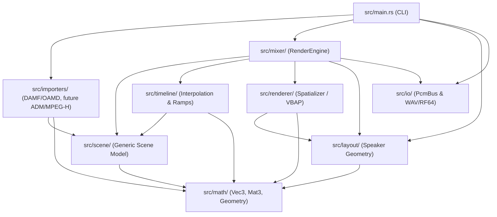

# objrender — Architecture & Technical Design Specification

> **Status:** Architecture Specification (Phase 1 MVP In Progress)  
> **License:** `GPL-3.0-or-later` (see `LICENSE`)

This document defines the complete software architecture, mathematical models, DSP algorithms, Rust data types, crate selections, phased implementation plan, verification strategy, and technical risks for **objrender**.

---

## Table of Contents

1. [System Architecture & Design Principles](#1-system-architecture--design-principles) *(Deliverable 1)*
2. [Module Architecture & Dependency Diagram](#2-module-architecture--dependency-diagram) *(Deliverable 2)*
3. [End-to-End Data Flow](#3-end-to-end-data-flow) *(Deliverable 3)*
4. [Spatialization Engine Analysis & Recommendation](#4-spatialization-engine-analysis--recommendation)
5. [Temporal Processing (`src/timeline/`)](#5-temporal-processing-srctimeline)
6. [Mixing & Gain Staging (`src/mixer/`)](#6-mixing--gain-staging-srcmixer)
7. [Export & File I/O (`src/io/`)](#7-export--file-io-srcio)
8. [Rust Data Structures & Core Traits](#8-rust-data-structures--core-traits) *(Deliverables 4 & 5)*
9. [Core Algorithms & Pseudocode](#9-core-algorithms--pseudocode) *(Deliverable 6)*
10. [Crate Selection & Justification](#10-crate-selection--justification)
11. [Phase 1 MVP Specification](#11-phase-1-mvp-specification) *(Deliverable 7)*
12. [Phased Implementation Plan (Phases 1–6)](#12-phased-implementation-plan-phases-16) *(Deliverable 8)*
13. [Testing & Verification Strategy](#13-testing--verification-strategy) *(Deliverable 9)*
14. [Technical Risks & Mitigations](#14-technical-risks--mitigations) *(Deliverable 10)*

---

## 1. System Architecture & Design Principles

### 1.1 Strict Boundary: Importer Layer vs. Rendering Core

`objrender` enforces a hard architectural boundary between **format-specific importers** and the **format-agnostic rendering core**:

- **Format Importer Layer** (`src/importers/damf/`, and future importers such as `src/importers/adm/` or `src/importers/mpegh/`):
  - Parses external metadata and audio containers (e.g., decoded DAMF filesets from `truehdd` / `harletty` consisting of a manifest descriptor, multichannel CAF audio essence, and OAMD / ETSI TS 103 420 timeline metadata).
  - Translates format-specific spatial conventions (room-cube coordinates, bed channels, divergence/trim flags, sample offsets) into generic `Scene`, `AudioObject`, and `Keyframe` primitives.
- **Rendering Core** (`math`, `layout`, `scene`, `timeline`, `renderer`, `mixer`, `io`):
  - Operates **exclusively** on generic 3D audio objects, arbitrary speaker coordinates, timelines, and planar PCM buses.
  - **Core Invariant:** No file, struct, trait, enum, or function inside the rendering core may import from `src/importers/` or assume any format-specific metadata convention (`OAMD`/`DAMF`, `ADM`, `IAMF`, `MPEG-H`).

### 1.2 License, Omniphony Reuse & Naming Hygiene

- **Omniphony Reuse Policy (`GPL-3.0-or-later`):** `objrender` is licensed under `GPL-3.0-or-later` so it can selectively reuse and adapt battle-tested pure-Rust DSP/VBAP/geometry modules from [Omniphony](https://github.com/mgth/Omniphony) (`convhull`, `vbap_native` with ITU-R BS.2127 virtual poles, coplanar virtual face centres, 3D spread, and zero-allocation `Vbap3dScratch`), preserving upstream copyright and license headers. Real-time server backends, OSC, GUI studio, and plugin ABI bridge complexity from Omniphony are intentionally **not** reproduced.
- **Naming & Trademark Hygiene:** Keep all project, crate, binary, module, and API identifiers grounded in neutral technical and open-standard terms (`objrender`, `importers::damf`, `OAMD`, `ADM`, `CAF`, `RF64`) rather than third-party consumer trademarks.
- **Anti-Overengineering Constraints:** Built for a small team. No ECS, no runtime plugin systems, no ABI bridges, no DI containers, no service locators, and no generic "audio engine" frameworks.

### 1.3 Canonical Core Coordinate System

Inside the rendering core, all positions are defined in a **right-handed listener-centered 3D Cartesian coordinate system** with the listener at the origin `(0.0, 0.0, 0.0)`:

| Axis | Positive Direction (`+`) | Negative Direction (`-`) |
| --- | --- | --- |
| **X** | Right (`+X`) | Left (`-X`) |
| **Y** | Front (`+Y`) | Back (`-Y`) |
| **Z** | Up / Zenith (`+Z`) | Down / Nadir (`-Z`) |

Unit vectors on the unit sphere $S^2$ represent directions; radial distance $r = \|\mathbf{p}\|_2$ represents proximity relative to the nominal speaker sphere ($r = 1.0$).

#### Spherical Convention (ITU-R BS.2076 / Pulkki VBAP)

- **Azimuth $\theta \in (-180^\circ, +180^\circ]$:**
  - $0^\circ$ = directly Front (`+Y`)
  - $+90^\circ$ = directly Left (`-X`)
  - $-90^\circ$ = directly Right (`+X`)
  - $\pm 180^\circ$ = directly Back (`-Y`)
- **Elevation $\phi \in [-90^\circ, +90^\circ]$:**
  - $0^\circ$ = ear-level horizontal plane ($z = 0$)
  - $+90^\circ$ = zenith / directly overhead (`+Z`)
  - $-90^\circ$ = nadir / directly below (`-Z`)

**Spherical $\leftrightarrow$ Cartesian Conversion:**

$$
x = -r \cos\phi \sin\theta, \qquad
y =  r \cos\phi \cos\theta, \qquad
z =  r \sin\phi
$$

$$
r = \sqrt{x^2 + y^2 + z^2}, \qquad
\theta = \operatorname{atan2}(-x, y), \qquad
\phi = \operatorname{asin}\!\left(\operatorname{clamp}\!\left(\frac{z}{r}, -1, 1\right)\right)
$$

*(Note: When $r = 0$, direction is undefined; see Section 4.3 for interior origin handling.)*

#### Format Importer Translation Example (`src/importers/damf/`)

In decoded OAMD / DAMF room-cube coordinates $(a_x, a_y, a_z)$ where $a_x \in [0, 1]$ spans Left $\to$ Right, $a_y \in [0, 1]$ spans Front $\to$ Back, and $a_z \in [-1, 1]$ spans Floor $\to$ Ceiling (with ear level at $a_z = 0$):

$$
x_{\text{core}} = 2 a_x - 1, \qquad
y_{\text{core}} = 1 - 2 a_y, \qquad
z_{\text{core}} = a_z
$$

This mapping lives **exclusively inside `src/importers/damf/`** (and is reversible only at import boundaries). The core never sees $[0, 1]$ room-cube semantics.

### 1.4 Speaker Role Separation (`FullRange` vs. `Lfe`)

Low-Frequency Effects (`.1` / LFE) channels **must not** participate in 2D/3D spatial triangulation or VBAP panning hulls:
- A subwoofer has no valid 3D directional localization cue in VBAP and including it in a convex hull distorts adjacent triangles and steals wideband energy from main speakers.
- Therefore, `Speaker` carries `role: SpeakerRole` (`FullRange` or `Lfe`).
- `VbapRenderer::build()` filters strictly to `SpeakerRole::FullRange` speakers when constructing arcs/triplets.
- Audio objects tagged `ObjectRole::Lfe` bypass directional spatialization and route directly to the target layout's `Lfe` speaker(s) (split equally by energy if multiple LFE speakers exist).
- If the target layout has **no `Lfe` speaker** (e.g., Stereo 2.0), behavior is governed by an explicit `LfePolicy` (`Drop` by default per cinema/broadcast safety, or `FoldDown { gain_db }` if requested by the user).

---

## 2. Module Architecture & Dependency Diagram

### 2.1 Planned Source Tree

```text
objrender/
├── Cargo.toml
├── CLAUDE.md
├── README.md
├── docs/
│   └── ARCHITECTURE.md
├── src/
│   ├── lib.rs              # Public library API exports
│   ├── main.rs             # Lean CLI binary for offline rendering
│   ├── math/               # Vec3, Mat3, spherical coords, 2D/3D geometry helpers
│   ├── layout/             # Speaker, SpeakerRole, SpeakerLayout, presets & TOML loader
│   ├── scene/              # Scene, AudioObject, Keyframe, SpatialParams, AudioSource trait
│   ├── timeline/           # Keyframe cursor, trajectory & gain interpolation, ramp smoothing
│   ├── renderer/           # Spatializer trait, 1D/2D/3D VBAP engine, future MDAP/HOA
│   ├── mixer/              # RenderEngine orchestration, multi-object summing, clipping/norm
│   ├── io/                 # Planar PcmBus, SampleWriter trait, streaming WAV & RF64 writer
│   └── importers/          # Isolated format adapters (damf/oamd; future adm, mpegh)
└── tests/                  # Integration tests & golden render verification
```

### 2.2 Acyclic Module Dependency Graph



**Dependency Contract Check:**
- `importers` points *only* inward toward `scene` and `math`.
- Zero arrows point from any core module back to `importers`.
- Adding a future `src/importers/adm/` or `src/importers/mpegh/` adapter requires adding one importer module implementing `SceneImporter`, with **zero edits** to `scene`, `timeline`, `renderer`, `mixer`, `layout`, or `io`.

---

## 3. End-to-End Data Flow

### 3.1 High-Level Pipeline

```text
[Decoded Input: truehdd / harletty (DAMF/OAMD + CAF), or Synthetic Scene]
                            │
                            ▼
                 [DamfImporter::import()]
                            │ (maps coords, trims, beds/objects)
                            ▼
                     [SceneBuilder]
                            │
                            ▼
         [Scene: sample_rate, total_frames, Vec<AudioObject>]
                            │
                            ▼
             [RenderEngine::render() — Block Loop]
      ┌─────────────────────┼─────────────────────┐
      ▼                     ▼                     ▼
[AudioSource]         [Timeline]          [Spatializer (VBAP)]
(mono block PCM)   (t0..t1 interp)       (gains[0..N_spk])
      └─────────────────────┼─────────────────────┘
                            ▼
        [Linear Gain Ramp + Accumulate into PcmBus (f64)]
                            │
                            ▼
             [Mixer Headroom / Clipping Policy]
                            │
                            ▼
        [WaveWriter::write_block() — Interleaved f32/f64]
                            │
                            ▼
          [WaveWriter::finalize() — WAV or RF64]
```

### 3.2 Per-Block DSP Execution Flow

To maintain deterministic offline execution with zero inner-loop heap allocations:

1. **Initialization (`RenderEngine` setup):**
   - Build spatializer precomputation once from `SpeakerLayout` (e.g., triangulate hull and invert $3 \times 3$ speaker matrices $\mathbf{L}_t^{-1}$).
   - Allocate scratch buffers once:
     - `mono_buf: Vec<f64>` of length `block_size` (default `64` samples $\approx 1.33\text{ ms}$ at $48\text{ kHz}$),
     - `gains_start: Vec<f64>` and `gains_end: Vec<f64>` of length `num_speakers`,
     - `bus: PcmBus` containing `num_speakers` planar `Vec<f64>` buffers of length `block_size`.
2. **Outer Loop (`frame = 0; frame < total_frames; frame += block_size`):**
   - `frames_in_block = min(block_size, total_frames - frame)`.
   - `bus.clear(frames_in_block)`.
   - **Inner Object Loop (for each `obj` in `scene.objects`):**
     - Skip object if `frame >= obj.end_frame()` or `frame + frames_in_block <= obj.start_frame()`.
     - Read `frames_in_block` samples from `obj.source` into `mono_buf`.
     - If `obj.role == ObjectRole::Lfe`: evaluate gain at block start/end, route directly to LFE channel(s) in `bus` according to `LfePolicy`, continue.
     - Evaluate `Timeline` state at `t_start = frame` and `t_end = frame + frames_in_block`: `(pos0, gain0, params0)` and `(pos1, gain1, params1)`.
     - Compute spatial weights `spatializer.compute_gains(pos0, params0, &mut gains_start)` and `spatializer.compute_gains(pos1, params1, &mut gains_end)`, multiplying each vector by the object's scalar linear gain (`gain0`, `gain1`).
     - **Sample-Ramp Accumulation (tight, branchless loop):** for each active speaker channel `ch` where `|gains_start[ch]| > 0 || |gains_end[ch]| > 0`:
       $$
       \Delta g = \frac{g_{\text{end}}[ch] - g_{\text{start}}[ch]}{\text{frames\_in\_block}}, \qquad
       \text{bus}[ch][s] \mathrel{+}= \text{mono\_buf}[s] \cdot (g_{\text{start}}[ch] + s \cdot \Delta g)
       $$
   - Apply online headroom scaling (`FixedHeadroomDb`) if configured and update per-channel `ChannelStats` (peak amplitude, RMS sum-of-squares, clipped sample count > 1.0).
   - Pass `bus` slice to `writer.write_block(&bus, frames_in_block)`.
3. **Finalization:**
   - Call `writer.finalize()` (patches RIFF or promotes to RF64 `ds64`).
   - Return `RenderReport` (peak dBFS per channel, integrated RMS, RF64 promotion status).

---

## 4. Spatialization Engine Analysis & Recommendation

### 4.1 Comparative Evaluation

| Strategy | Subjective Spatial Quality | Computational Cost | Implementation Simplicity | Suitability for Discrete Object Content (OAMD/DAMF) |
| --- | --- | --- | --- | --- |
| **VBAP** (Vector Base Amplitude Panning) | **High localization precision** for discrete objects; minimal comb filtering since at most 3 adjacent speakers (or 2 in 2D) are active; phantom image width depends on speaker spacing. | **Very low.** Precomputation $O(S^3)$ once at startup; runtime per block is scanning $T$ triangles ($O(T)$ dot products, typically $T \le 40$) + 3 MACs/sample/object. | **High.** Straightforward 3D vector algebra, deterministic behavior, trivial to inspect gains mathematically. | **Excellent.** Preserves point-source clarity of discrete objects; natively maps speaker-anchored and moving objects across arbitrary 2D/3D hulls. |
| **DBAP** (Distance-Based Amplitude Panning) | Diffuse, wide phantom images; weak localization inside irregular listening sweet spots because every speaker contributes energy regardless of direction. | **Low–Moderate.** Evaluates Euclidean distances to all $S$ speakers and mixes across all $S$ channels per object ($O(S \cdot N)$). | **Very high.** No convex hull or matrix inversion needed; works on arbitrary point clouds. | **Poor for primary discrete objects.** Blurs localized cinema objects across the entire room; better suited as a fallback for non-convex speaker installations (e.g., line arrays/courtyards). |
| **MDAP** (Multiple Direction Amplitude Panning) | **Superior for wide/diffuse objects.** Eliminates the "pinpoint collapse" when an object lands near a speaker while keeping point localization when spread $= 0$. | **Low–Moderate.** Runs $K$ VBAP lookups per object per block ($K \in [3, 9]$ depending on spread), then merges into one gain vector before sample mixing! **Same sample-loop cost as VBAP.** | **Moderate.** Clean additive layer directly on top of VBAP using orthogonal tangent vectors around $\mathbf{p}$. | **Ideal match for OAMD `size` / `divergence`.** Directly models volumetric object width without touching the sample mixer. |
| **Internal Ambisonics (HOA) + AllRAD Decode** | Smooth spatial continuity and inherent spread/rotation, but **lower angular sharpness** (order-limited spatial blurring, e.g., 3rd/5th order requires 16/36 channels and still exhibits side-lobe leakage / phase coloration). | **High.** Every object encodes into $(L+1)^2$ HOA channels (e.g., 25 or 36 buses for 4th/5th order), plus full matrix decode per block ($36 \times S$ channels). | **Complex.** Requires spherical harmonics, dual-band max-$r_E$ weighting, AllRAD virtual t-designs, and shelf filters. | **Suboptimal as MVP.** Blurs hard-panned cinema objects onto opposite speakers unless very high order ($L \ge 7$, 64 intermediate channels) is used, wasting CPU and muddying beds. |
| **Hybrid (VBAP + MDAP + Direct Bed / HOA Ambience)** | **Best overall fidelity.** Discrete objects keep sharp VBAP/MDAP localization; beds or high-divergence ambient elements remain smooth and enveloping. | **Low.** Same per-sample cost as VBAP ($S$ channels); only spread/bed routing differs at setup/block boundaries. | **Moderate (incremental).** Builds naturally on VBAP + `Spatializer` trait without refactoring the mixer or bus. | **Optimal long-term target.** Matches commercial cinema/home-theater rendering behavior closely while staying lean. |

### 4.2 MVP Recommendation: 2D/3D VBAP

For Phase 1–3, **VBAP** is the clear winner:
1. **Matches the problem domain:** Cinema/home-theater OAMD objects are discrete point or finite-size sources, not spherical soundfields.
2. **Arbitrary layouts natively:** Handles Stereo, 5.1, 7.1, 5.1.4, 7.1.4, 9.1.6, and asymmetric custom speaker rigs through pure 3D geometry.
3. **Zero channel-explosion penalty:** Mixing happens directly into the target speaker `PcmBus` ($S$ channels), rather than an intermediate 25–64 channel Ambisonic bus.
4. **Mathematically verifiable:** Speaker-aligned directions yield exact `[0..1..0]` unit gains; intermediate points yield exact $L_2$-normalized energy conservation ($\sum g_i^2 = 1$).

#### Handling Arbitrary & Incomplete Hulls in VBAP

Real speaker layouts are rarely closed spheres around the listener (for example, 7.1.4 has no speakers below the ear plane $z < 0$, and Stereo 2.0 covers only $\pm 30^\circ$ in front):

- **Case 0 (`N == 0` FullRange speakers):** Error at layout validation.
- **Case 1 (`N == 1` Mono):** Trivial passthrough `g[0] = 1.0`.
- **Case 2 (`N >= 2`, Coplanar / 2D Horizontal Layout, e.g. Stereo, 5.1, 7.1):**
  - Detected automatically when $\max_i |z_i| < \varepsilon_{\text{planar}}$ (e.g., all elevations within $\pm 5^\circ$ of horizontal).
  - Project directions onto the horizontal XY circle and sort speakers by azimuth $\theta \in (-\pi, \pi]$.
  - Form adjacent 2D speaker pairs $(s_k, s_{k+1})$ around the circle.
  - **Open-arc / wide-gap handling:** If an angular gap between consecutive speakers exceeds $\sim 170^\circ$ (such as Stereo $2.0$ with L at $+30^\circ$ and R at $-30^\circ$, leaving a $300^\circ$ rear gap where $2\times 2$ pair determinants become degenerate or invert sign), insert a **virtual rear speaker** at $180^\circ$ (`-Y`) during hull construction, and redistribute any weight falling on the virtual rear speaker equally onto its two bounding real speakers (`L` and `R`) before $L_2$ normalization (or clamp rear directions smoothly onto the front L-R arc, configurable via `OpenHullPolicy`).
- **Case 3 (`N >= 3`, 3D & Surround Layouts, e.g. 5.1, 7.1, 5.1.4, 7.1.4, 9.1.6, custom domes):**
  - Powered directly by Omniphony's pure-Rust `convhull` + `vbap_native` core (`prepare_triangulation`, `invert_ls_mtx_3d`, `vbap3d_into`).
  - Automatically injects ITU-R BS.2127 virtual pole speakers ($\pm 90^\circ$) for open hemispheres/horizontal rings (`OutOfHullMode::VirtualPoles`) and virtual face centres on coplanar quads (such as the 4-speaker ceiling in 5.1.4/7.1.4), downmixing virtual gains onto adjacent real speakers before $L_2$ normalization.
  - Supports 3D spread/MDAP natively via `spread_deg` and zero-allocation `Vbap3dScratch`.

### 4.3 Advanced Evolution (No Core Rewrites)

Because the renderer depends only on the `Spatializer` trait (`compute_gains(&self, pos: Vec3, params: SpatialParams, out_gains: &mut [f64])`), the following Phase 3–6 upgrades drop in seamlessly:

1. **MDAP Object Width / Spread:** Map `params.width` $\in [0, 1]$ and `params.divergence` $\in [0, 1]$ to a ring of $K$ auxiliary direction vectors (e.g., 4 or 8 tangent points plus the center vector) distributed at angular radius $\alpha(\text{width})$ around $\hat{\mathbf{p}}$, evaluate VBAP for each point, weight-sum the squared energies, and $L_2$-normalize.
2. **Near-Origin Smooth Transition ($r \to 0$):** When an object passes directly through the listener at `(0, 0, 0)` ($r < r_{\text{min}}$, e.g. $r_{\text{min}} = 0.25$), blend smoothly between directional VBAP gains $\mathbf{g}_{\text{vbap}}$ and omnidirectional equal-energy gains $\mathbf{g}_{\text{omni}} = \frac{1}{\sqrt{S}}[1, \dots, 1]^T$:
   $$
   w = \operatorname{smoothstep}(0, r_{\text{min}}, r), \qquad
   \mathbf{g} = \operatorname{normalize}_{L_2}\!\big(w\,\mathbf{g}_{\text{vbap}} + (1 - w)\,\mathbf{g}_{\text{omni}}\big)
   $$
   This eliminates directional snapping when an object crosses `(0, 0, 0)`.
3. **Optional DBAP / HOA Backends:** Implement `DbapRenderer` or `HoaAllRadRenderer` behind `Spatializer` for exotic non-convex installations or comparative listening tests without altering `Scene`, `Timeline`, `Mixer`, or `io`.

---

## 5. Temporal Processing (`src/timeline/`)

### 5.1 Block-Based Evaluation Granularity

Offline rendering evaluates object positions and metadata at fixed control sub-block boundaries (`block_size = 64` samples by default; $1.33\text{ ms}$ at $48\text{ kHz}$, $0.67\text{ ms}$ at $96\text{ kHz}$):
- **Why 64 samples?**
  - Sub-1.5 ms spatial update rate exceeds human spatial temporal resolution while amortizing `Spatializer::compute_gains` across 64 samples ($64\times$ faster than per-sample VBAP).
  - Keeps inner sample loops strictly linear and auto-vectorizable (`SIMD`-ready in Phase 4).

### 5.2 Object Movement & Keyframe Interpolation

Each `AudioObject` stores a sorted slice of `Keyframe`s ordered by `frame: u64`. Between keyframes $k_a$ (at `frame_a`) and $k_b$ (at `frame_b`), let normalized progress $u = \frac{t - \text{frame}_a}{\text{frame}_b - \text{frame}_a} \in [0, 1]$:

- **Cartesian Linear (`InterpMode::Linear`, default):**
  $$\mathbf{p}(t) = (1 - u)\mathbf{p}_a + u\mathbf{p}_b$$
  Matches OAMD / DAMF room-cube trajectory semantics cleanly (straight lines across the room pass through the interior rather than hugging walls).
- **Spherical Geodesic (`InterpMode::Spherical`):**
  Interpolates direction via SLERP on $S^2$ and radius linearly, useful for constant-radius rotational sweeps.
- **Step / Ramp Boundaries:** If a keyframe occurs *mid-block* (`frame_a < keyframe.frame < frame_b`), the `RenderEngine` can split the block at `keyframe.frame` (if `split_on_step == true` for zero-duration jumps) or interpolate across the step boundary with a short ramp so instantaneous teleports never click.

### 5.3 Parameter Automation, Temporal Smoothing & Crossfades

- **Automated scalar parameters** (`gain`, `width`, `divergence`) interpolate linearly over $u \in [0, 1]$.
- **Per-Sample Linear Gain Ramp (Zipper-Noise Elimination):**
  Never apply step gain changes at block boundaries. At every block `[t0, t1)`:
  1. Compute target channel gain vector $\mathbf{g}_{\text{start}}$ at `t0` and $\mathbf{g}_{\text{end}}$ at `t1`.
  2. Multiply by scalar object gain at `t0` and `t1`.
  3. Ramp each speaker gain sample-by-sample via `g += dg`.
- **Anti-Click Crossfade on Discontinuities:** If an object has an instantaneous cut/teleport (`Keyframe::discontinuous = true`, or object activation/deactivation mid-stream), apply a short raised-cosine (Hann) crossfade over $N_{\text{xfade}}$ samples (e.g., $128$ samples $\approx 2.67\text{ ms}$ at $48\text{ kHz}$) between old gains and new gains.

### 5.4 Energy Preservation Across Transitions

When panning rapidly across a triangle edge from speaker $A$ to speaker $B$, purely linear gain interpolation $\mathbf{g}(s) = (1-\alpha)\mathbf{g}_A + \alpha\mathbf{g}_B$ experiences a theoretical midpoint amplitude dip: at $\alpha = 0.5$ between two orthogonal channels $[1, 0]$ and $[0, 1]$, $[0.5, 0.5]$ has $L_2$ norm $\sqrt{0.5} \approx 0.7071$ ($-3.01\text{ dB}$).

**How `objrender` avoids audible energy pumping:**
1. Because `Spatializer` is evaluated every **64 samples ($1.33\text{ ms}$)** rather than over coarse metadata frames (e.g., $5\text{–}40\text{ ms}$), $\Delta\mathbf{g}$ per sub-block is small even for fast pans: moving $90^\circ$ in $50\text{ ms}$ changes angle by only $2.4^\circ$ per 64-sample block, keeping the linear ramp midpoint error below **$0.01\text{ dB}$**.
2. For extreme edge cases where $\|\mathbf{g}_{\text{start}} + \mathbf{g}_{\text{end}}\|_2$ diverges significantly within a single block (large angular jump inside one 64-sample block), `Timeline` / `Mixer` supports sub-block splitting (`max_angle_step_deg`, e.g. $5^\circ$) or constant-power spherical gain slerp between normalized gain vectors so $L_2$ energy remains invariant within $< 0.05\text{ dB}$.

---

## 6. Mixing & Gain Staging (`src/mixer/`)

### 6.1 Internal Mixing Precision (`f64` Planar `PcmBus`)

All spatial summation runs in **64-bit IEEE floating point (`f64`)** on a **planar** buffer (`channels[ch][sample]`):
- **Why `f64` internally?** Summing up to 128 simultaneous objects over millions of samples accumulates rounding drift in `f32` (24-bit mantissa) and leaves zero overhead for calibration headroom or 2-pass peak normalization. `f64` (53-bit mantissa) preserves full dynamic range cleanly before final export quantization (`f32` or `f64`).
- **Why planar?** Each speaker gain ramp iterates linearly over contiguous memory `bus.channel_mut(ch)` and `mono_buf`, maximizing CPU cache locality and SIMD vectorization (Phase 4). Interleaving happens **only once** at the `io` boundary right before disk write.

### 6.2 Multi-Object Summation & Panning Normalization

- **Superposition:** Active objects sum linearly into the speaker bus:
  $$
  y_c[n] = \sum_{m=1}^{M} g_{m,c}[n] \cdot x_m[n]
  $$
- **Panning Normalization Policy:** Default is **constant-power $L_2$ normalization** ($\sqrt{\sum_c g_c^2} = 1$) appropriate for uncorrelated / acoustically diffused loudspeaker playback in typical listening rooms. A configurable `NormMode` (`L2Power` default, `L1Amplitude` for acoustically coherent near-field/test rigs) keeps calibration transparent.

### 6.3 Headroom, Clipping Protection & Loudness Strategy

Because `objrender` renders **offline**, it never needs aggressive dynamic-range compression during normal rendering unless explicitly desired:

| `ClippingPolicy` Mode | Behavior | Recommended Use Case |
| --- | --- | --- |
| `PassThrough` *(Default)* | Writes raw summed `f64`/`f32` samples with zero attenuation; tracks and reports peak dBFS and samples $> 0\text{ dBFS}$ (`|x| > 1.0`) in `RenderReport`. | Archival / studio floating-point intermediate masters (IEEE float files preserve headroom $> 0\text{ dBFS}$ losslessly). |
| `FixedHeadroomDb(f64)` | Applies constant pre-write attenuation (e.g., `-6.0 dB` $\rightarrow \times 10^{-6/20}$) in single pass. | Fast predictable export when combining dense object mixes without peaking $> 0\text{ dBFS}$. |
| `TwoPassPeakNormalize { target_dbfs }` | Pass 1 computes exact global peak across all channels (counting peaks to `NullWriter`); Pass 2 scales entire render by `target_linear / max_peak`. | Guaranteed zero clipping, zero dynamic pumping, exact peak alignment (feasible solely because `objrender` is offline!). |
| `Limiter / Loudness` *(Phase 6)* | Optional ITU-R BS.1770-4 / EBU R128 integrated loudness measurement and lookahead true-peak limiter. | Cinema/broadcast compliance deliveries. |

---

## 7. Export & File I/O (`src/io/`)

### 7.1 Why RF64 Is Essential

Standard RIFF WAV uses 32-bit unsigned chunk sizes (`u32`, max `4,294,967,295` bytes $\approx 4.29\text{ GB}$ / $4.00\text{ GiB}$). Multichannel cinema renders exceed this rapidly:

| Configuration (48 kHz) | Byte Rate | 2-Hour Feature Size | Hits 4 GiB RIFF Limit At |
| --- | --- | --- | --- |
| `7.1.4` (12 ch) `f32` | $2.304\text{ MB/s}$ | $16.59\text{ GB}$ ($15.45\text{ GiB}$) | **~31 min 04 s** |
| `7.1.4` (12 ch) `f64` | $4.608\text{ MB/s}$ | $33.18\text{ GB}$ ($30.90\text{ GiB}$) | **~15 min 32 s** |
| `9.1.6` (16 ch) `f32` | $3.072\text{ MB/s}$ | $22.12\text{ GB}$ ($20.60\text{ GiB}$) | **~23 min 18 s** |

### 7.2 Streaming WAV / RF64 Writer (`JUNK` $\to$ `ds64` Promotion)

`objrender` implements EBU Tech 3306 (RF64) natively in `src/io/wave.rs` using the standard **single-pass `JUNK`-to-`ds64` promotion pattern**:

1. **Header Reservation at `create()`:**
   - Bytes `0..12`: `"RIFF"`, placeholder `0x0000_0000`, `"WAVE"`.
   - Bytes `12..48`: `"JUNK"` chunk of exact size `28` payload bytes (`36` bytes total with 8-byte chunk header) — identical byte length to an RF64 `ds64` chunk with zero extra table entries!
   - `"fmt "` chunk (`40` bytes payload) using **`WAVE_FORMAT_EXTENSIBLE` (`0xFFFE`)**:
     - `wBitsPerSample`: `32` (`Float32`) or `64` (`Float64`)
     - `wValidBitsPerSample`: `32` or `64`
     - `dwChannelMask`: bitmask built from `SpeakerLayout::channel_mask()` (or `0` for custom/arbitrary layouts $> 18$ channels)
     - `SubFormat`: `KSDATAFORMAT_SUBTYPE_IEEE_FLOAT` (`00000003-0000-0010-8000-00aa00389b71`)
   - `"data"` chunk header (`8` bytes: `"data"`, placeholder `0`).
2. **Streaming Interleaved Writes:**
   - Convert planar `PcmBus` (`&[Vec<f64>]`) block into a reusable interleaved byte buffer (`f32::to_le_bytes` or `f64::to_le_bytes`) and write sequentially via `BufWriter<File>`.
   - Memory footprint stays constant ($O(\text{channels} \times \text{block\_size})$), regardless of whether the output file is 10 MB or 50 GB.
3. **O(1) Header Finalization (`finalize()`):**
   - Flush `BufWriter`, seek to header offsets in $O(1)$ without touching audio payload bytes:
   - **If `riff_size <= u32::MAX` AND `data_bytes <= u32::MAX`:** keep `"RIFF"` and `"JUNK"`, write 32-bit `riff_size` and `data_bytes`. Output is a 100% standard RIFF WAV readable by every tool.
   - **If either exceeds `u32::MAX` (or `force_rf64 == true`):**
     - Overwrite `"RIFF"` $\to$ `"RF64"` and set 32-bit RIFF size $\to$ `0xFFFF_FFFF`.
     - Overwrite `"JUNK"` $\to$ `"ds64"` (`size = 28`), writing 64-bit `riffSize`, 64-bit `dataSize`, and 64-bit `sampleCount` (frames).
     - Set 32-bit `"data"` chunk size $\to$ `0xFFFF_FFFF`.

### 7.3 `f32` vs. `f64` Output Formats

- **`PCM Float32` (`SampleFormat::Float32`, default):** 24-bit mantissa (~144 dB dynamic range before exponent scaling), half the disk bandwidth/size of `f64`, universal compatibility across DAWs, FFmpeg, players, and hardware drivers.
- **`PCM Float64` (`SampleFormat::Float64`):** 53-bit mantissa (~318 dB dynamic range), ideal for scientific/mastering verification and lossless pass-through from the `f64` internal `PcmBus`.

---

## 8. Rust Data Structures & Core Traits

All core structs use plain owned/borrowed Rust types, explicit error values, and zero runtime reflection or DI frameworks.

### 8.1 Core Data Structures

```rust
// --- src/math/mod.rs ---

#[derive(Debug, Clone, Copy, PartialEq)]
pub struct Vec3 {
    pub x: f64, // -X Left, +X Right
    pub y: f64, // -Y Back, +Y Front
    pub z: f64, // -Z Down, +Z Up
}

#[derive(Debug, Clone, Copy, PartialEq)]
pub struct Mat3 {
    /// Column-major 3x3 matrix: cols[c][r]
    pub cols: [[f64; 3]; 3],
}

#[derive(Debug, Clone, Copy, PartialEq)]
pub struct SphericalCoord {
    pub azimuth_deg: f64,   // (-180, 180], 0 = Front (+Y), +90 = Left (-X)
    pub elevation_deg: f64, // [-90, 90], 0 = Horizon, +90 = Zenith (+Z)
    pub radius: f64,        // >= 0.0
}

// --- src/layout/mod.rs ---

#[derive(Debug, Clone, Copy, PartialEq, Eq, Hash)]
pub struct SpeakerId(pub usize);

#[derive(Debug, Clone, Copy, PartialEq, Eq)]
pub enum SpeakerRole {
    FullRange,
    Lfe,
}

#[derive(Debug, Clone, PartialEq)]
pub struct Speaker {
    pub id: SpeakerId,
    pub label: String,        // e.g. "L", "R", "C", "LFE", "Ltf", or custom "S01"
    pub position: Vec3,       // Normalized or physical 3D coords relative to listener
    pub role: SpeakerRole,
    pub channel_mask_bit: Option<u32>, // Optional WAVE_FORMAT_EXTENSIBLE bit
}

#[derive(Debug, Clone)]
pub struct SpeakerLayout {
    pub name: String,
    pub speakers: Vec<Speaker>,
}

// --- src/scene/mod.rs ---

#[derive(Debug, Clone, Copy, PartialEq, Eq, Hash)]
pub struct ObjectId(pub u32);

#[derive(Debug, Clone, Copy, PartialEq, Eq)]
pub enum ObjectRole {
    Dynamic, // Full 3D object spatialized via Spatializer
    Bed,     // Fixed-position channel-like object (still positioned in 3D or mapped cleanly)
    Lfe,     // Routed directly to Lfe speakers, bypassing VBAP
}

#[derive(Debug, Clone, Copy, PartialEq)]
pub struct SpatialParams {
    pub width: f64,       // [0.0, 1.0] point source -> full spread
    pub divergence: f64,  // [0.0, 1.0] bleed / diffusion factor
}

#[derive(Debug, Clone, Copy, PartialEq)]
pub enum InterpMode {
    Linear,    // Cartesian linear interpolation
    Spherical, // Geodesic SLERP on direction + linear radius
    Step,      // Hold until next keyframe
}

#[derive(Debug, Clone, Copy, PartialEq)]
pub struct Keyframe {
    pub frame: u64,
    pub position: Vec3,
    pub gain: f64,            // Linear gain multiplier (1.0 = 0 dB)
    pub spatial: SpatialParams,
    pub interp: InterpMode,
    pub discontinuous: bool,  // Triggers short anti-click crossfade if true
}

pub struct AudioObject {
    pub id: ObjectId,
    pub label: String,
    pub role: ObjectRole,
    pub priority: u8,
    pub start_frame: u64,
    pub frame_count: u64,
    pub initial_position: Vec3,
    pub initial_gain: f64,
    pub initial_spatial: SpatialParams,
    pub keyframes: Vec<Keyframe>, // Sorted ascending by `frame`
    pub source: Box<dyn AudioSource>,
}

pub struct Scene {
    pub sample_rate: u32,
    pub total_frames: u64,
    pub objects: Vec<AudioObject>,
}

// --- src/renderer/mod.rs ---

#[derive(Debug, Clone)]
pub struct VbapSimplex {
    pub speaker_indices: [usize; 3], // Real or virtual indices into internal table
    pub inv_matrix: Mat3,            // Precomputed L^{-1}
    pub is_2d: bool,
}

pub struct VbapRenderer {
    num_real_speakers: usize,
    full_range_map: Vec<usize>,      // Maps internal hull vertex -> SpeakerLayout index
    simplices: Vec<VbapSimplex>,
    // Virtual closure vertices map back to real speaker weights:
    virtual_redistributions: Vec<Vec<(usize, f64)>>,
    lfe_channels: Vec<usize>,
    near_origin_radius: f64,
}

// --- src/io/mod.rs ---

#[derive(Debug, Clone, Copy, PartialEq, Eq)]
pub enum SampleFormat {
    Float32,
    Float64,
}

pub struct PcmBus {
    channels: Vec<Vec<f64>>, // Planar: channels[ch][sample]
    block_size: usize,
}

#[derive(Debug, Clone, Copy)]
pub struct WaveConfig {
    pub sample_rate: u32,
    pub num_channels: u16,
    pub channel_mask: u32,
    pub format: SampleFormat,
    pub rf64_threshold_bytes: u64, // Default u32::MAX as u64; lowered in tests!
}

// --- src/mixer/mod.rs ---

#[derive(Debug, Clone, Copy, PartialEq)]
pub enum ClippingPolicy {
    PassThrough,
    FixedHeadroomDb(f64),
    TwoPassPeakNormalize { target_dbfs: f64 },
}

#[derive(Debug, Clone, Copy, PartialEq)]
pub enum LfePolicy {
    DropIfAbsent,
    FoldDownIfAbsent { gain_db: f64 },
}

#[derive(Debug, Clone, Copy)]
pub struct RenderConfig {
    pub block_size: usize, // Default: 64
    pub clipping: ClippingPolicy,
    pub lfe_policy: LfePolicy,
}

#[derive(Debug, Clone)]
pub struct ChannelStats {
    pub speaker_label: String,
    pub peak_linear: f64,
    pub sum_squares: f64,
    pub clipped_samples: u64, // Count where |sample| > 1.0
}

#[derive(Debug, Clone)]
pub struct RenderReport {
    pub frames_rendered: u64,
    pub rf64_promoted: bool,
    pub channels: Vec<ChannelStats>,
}
```

### 8.2 Minimal Core Traits (Only 4)

Every trait exists strictly to decouple an essential I/O or algorithmic boundary—nothing more:

```rust
/// 1. Decouples in-memory test signals from disk-streamed mono PCM tracks.
pub trait AudioSource: Send {
    fn total_frames(&self) -> u64;
    /// Reads up to `out.len()` mono samples starting at `frame_offset`, zero-padding any tail.
    fn read_frames(&mut self, frame_offset: u64, out: &mut [f64]) -> Result<usize, IoError>;
}

/// 2. Decouples external format parsers (DAMF/OAMD, future ADM/IAMF/MPEG-H, JSON/YAML) from the core Scene.
pub trait SceneImporter {
    fn import(&self) -> Result<Scene, ImportError>;
}

/// 3. Decouples spatial panning strategies (VBAP MVP, MDAP, DBAP, HOA) from Timeline & Mixer.
pub trait Spatializer: Sync {
    fn num_speakers(&self) -> usize;
    /// Writes normalized speaker gains into `out_gains` (length == num_speakers()).
    fn compute_gains(
        &self,
        position: Vec3,
        params: SpatialParams,
        out_gains: &mut [f64],
    );
}

/// 4. Decouples output sinks (WAV/RF64 file writer, two-pass null meter, in-memory test sink).
pub trait SampleWriter {
    fn write_block(&mut self, bus: &PcmBus, frames: usize) -> Result<(), IoError>;
    fn finalize(self: Box<Self>) -> Result<OutputMetadata, IoError>;
}
```

---

## 9. Core Algorithms & Pseudocode

### 9.1 `VbapRenderer::build(layout)`

```text
function VbapRenderer::build(layout: &SpeakerLayout) -> Result<VbapRenderer, LayoutError>:
    full_range = [(idx, spk.position.normalized()) for (idx, spk) in layout.speakers if spk.role == FullRange]
    lfe_channels = [idx for (idx, spk) in layout.speakers if spk.role == Lfe]

    if full_range.is_empty():
        return Err(NoFullRangeSpeakers)

    if full_range.len() == 1:
        return SingleSpeakerPassthrough(full_range[0], lfe_channels)

    max_abs_z = max(|pos.z| for (_, pos) in full_range)
    if max_abs_z < 0.087: // ~5 deg tolerance -> 2D horizontal layout
        // Project onto XY plane and sort by azimuth theta = atan2(-x, y)
        sorted = sort_by_azimuth(full_range)
        simplices = []
        virtual_map = []

        for k in 0..sorted.len():
            a = sorted[k]
            b = sorted[(k + 1) % sorted.len()]
            gap_rad = positive_angular_delta(a.az, b.az)

            if gap_rad >= 170_deg_in_rad:
                // Open arc (e.g. Stereo L/R 300-deg rear gap):
                // Insert virtual midpoint opposite to active front bisector
                v_dir = opposite_bisector(a.dir, b.dir)
                v_id = add_virtual_vertex(v_dir, redistribute_to=[(a.idx, 0.5), (b.idx, 0.5)])
                simplices.push(make_2d_pair(a, v_id))
                simplices.push(make_2d_pair(v_id, b))
            else if gap_rad > 1e-4:
                simplices.push(make_2d_pair(a, b))

        return VbapRenderer { simplices, virtual_map, is_2d: true, ... }

    else: // 3D layout (e.g. 5.1.4, 7.1.4, 9.1.6, custom dome)
        vertices = full_range positions on S^2
        if open_lower_hemisphere(vertices): // e.g. min(z) > -0.15
            ring = lowest_elevation_speakers(vertices)
            add_virtual_vertex((0, 0, -1), redistribute_to=equal_weights(ring))
        if open_upper_hemisphere(vertices): // e.g. max(z) < 0.15
            ring = highest_elevation_speakers(vertices)
            add_virtual_vertex((0, 0, +1), redistribute_to=equal_weights(ring))

        triangles = compute_3d_convex_hull(vertices) // Exact O(V^2) / incremental hull
        simplices = []
        for (i, j, k) in triangles:
            L = Mat3::from_cols(vertices[i], vertices[j], vertices[k])
            if abs(L.det()) > 1e-6:
                simplices.push(VbapSimplex {
                    speaker_indices: [i, j, k],
                    inv_matrix: L.inverse(),
                    is_2d: false,
                })

        return VbapRenderer { simplices, virtual_map, is_2d: false, ... }
```

### 9.2 `VbapRenderer::compute_gains(pos, params, out_gains)`

```text
function VbapRenderer::compute_gains(pos: Vec3, params: SpatialParams, out_gains: &mut [f64]):
    out_gains.fill(0.0)
    r = pos.length()

    if r < 1e-9:
        fill_omnidirectional_l2(out_gains, full_range_real_indices)
        return

    dir = pos / r
    if is_2d:
        dir = Vec3(dir.x, dir.y, 0.0).normalized_or_front()

    // Search simplex with non-negative gains (maximize min(g_i) for numerical robustness)
    best_min_g = -inf
    best_simplex = None
    best_g = [0.0; 3]

    for simplex in &self.simplices:
        g = simplex.inv_matrix * dir // In 2D mode, 3rd col is Z=[0,0,1], g[2]==0
        min_g = if simplex.is_2d { min(g[0], g[1]) } else { min(g[0], g[1], g[2]) }
        if min_g > best_min_g:
            best_min_g = min_g
            best_simplex = Some(simplex)
            best_g = g

    // Clamp tiny floating-point negatives (e.g. -1e-12 on edge boundaries)
    clamp_negatives_to_zero(&mut best_g)

    // Scatter simplex weights to real speakers (redistributing virtual vertices if hit)
    for slot in 0..simplex_arity:
        v_idx = best_simplex.speaker_indices[slot]
        w = best_g[slot]
        if w <= 0.0: continue
        if is_real_vertex(v_idx):
            out_gains[real_speaker_idx(v_idx)] += w
        else:
            for (real_idx, share) in virtual_redistributions[v_idx]:
                out_gains[real_idx] += w * share

    // L2 constant-power normalization
    norm = sqrt(sum(g * g for g in out_gains))
    if norm > 1e-12:
        for g in out_gains: g /= norm

    // Optional near-origin smooth blend when 0 < r < near_origin_radius
    if r < near_origin_radius:
        alpha = smoothstep(0.0, near_origin_radius, r)
        blend_with_omni_and_renormalize_l2(out_gains, alpha)
```

### 9.3 `render_scene(...)`

```text
function render_scene(scene, layout, spatializer, config, writer) -> Result<RenderReport, RenderError>:
    n_spk = layout.speakers.len()
    block_size = config.block_size
    bus = PcmBus::new(n_spk, block_size)
    mono_buf = vec![0.0; block_size]
    gains0 = vec![0.0; n_spk]
    gains1 = vec![0.0; n_spk]
    stats = init_stats(layout)

    for frame_start in (0..scene.total_frames).step_by(block_size):
        n_frames = min(block_size, (scene.total_frames - frame_start) as usize)
        bus.clear(n_frames)

        for obj in &mut scene.objects:
            if frame_start >= obj.end_frame() || frame_start + n_frames as u64 <= obj.start_frame:
                continue

            local_offset = frame_start.saturating_sub(obj.start_frame)
            obj.source.read_frames(local_offset, &mut mono_buf[..n_frames])?

            if obj.role == ObjectRole::Lfe:
                eval_lfe_gains(obj, frame_start, frame_start + n_frames as u64, &mut gains0, &mut gains1)
            else:
                state0 = timeline::eval_at(obj, frame_start)
                state1 = timeline::eval_at(obj, frame_start + n_frames as u64)
                spatializer.compute_gains(state0.position, state0.spatial, &mut gains0)
                spatializer.compute_gains(state1.position, state1.spatial, &mut gains1)
                scale_slice(&mut gains0, state0.gain)
                scale_slice(&mut gains1, state1.gain)

            inv_n = 1.0 / (n_frames as f64)
            for ch in 0..n_spk:
                g0 = gains0[ch]
                g1 = gains1[ch]
                if g0 == 0.0 && g1 == 0.0: continue
                dg = (g1 - g0) * inv_n
                out = bus.channel_mut(ch)
                mut g = g0
                for s in 0..n_frames:
                    out[s] += mono_buf[s] * g
                    g += dg

        apply_online_headroom_and_record_stats(&mut bus, n_frames, config.clipping, &mut stats)
        writer.write_block(&bus, n_frames)?

    meta = writer.finalize()?
    return Ok(RenderReport { frames_rendered: scene.total_frames, rf64_promoted: meta.rf64_promoted, channels: stats })
```

### 9.4 `WaveWriter::finalize()`

```text
function WaveWriter::finalize(mut self) -> Result<OutputMetadata, IoError>:
    self.buf_writer.flush()?
    file = self.buf_writer.into_inner()?

    data_bytes = self.frames_written * (self.num_channels as u64) * self.bytes_per_sample()
    total_file_bytes = HEADER_TOTAL_BYTES + data_bytes // HEADER_TOTAL_BYTES = 12 (RIFF) + 36 (JUNK/ds64) + 48 (fmt) + 8 (data hdr) = 104
    riff_size = total_file_bytes - 8

    needs_rf64 = riff_size > self.config.rf64_threshold_bytes || data_bytes > self.config.rf64_threshold_bytes

    if !needs_rf64:
        seek_write_u32_le(file, offset=4, riff_size as u32)
        seek_write_u32_le(file, offset=HEADER_TOTAL_BYTES - 4, data_bytes as u32)
        return Ok(OutputMetadata { rf64_promoted: false, total_bytes: total_file_bytes })
    else:
        seek_write_bytes(file, offset=0, b"RF64")
        seek_write_u32_le(file, offset=4, 0xFFFF_FFFF)
        // Overwrite JUNK chunk at offset 12 with ds64 (total 36 bytes: 8 hdr + 28 payload)
        seek_write_bytes(file, offset=12, b"ds64")
        seek_write_u32_le(file, offset=16, 28)
        seek_write_u64_le(file, offset=20, riff_size)          // 64-bit RIFF size
        seek_write_u64_le(file, offset=28, data_bytes)         // 64-bit data size
        seek_write_u64_le(file, offset=36, self.frames_written)// 64-bit sample count
        seek_write_u32_le(file, offset=44, 0)                  // tableLength = 0
        seek_write_u32_le(file, offset=HEADER_TOTAL_BYTES - 4, 0xFFFF_FFFF)
        return Ok(OutputMetadata { rf64_promoted: true, total_bytes: total_file_bytes })
```

---

## 10. Crate Selection & Justification

Every external dependency is vetted for `MIT OR Apache-2.0` compatibility, low compile bloat, and clear justification:

| Category | Recommended Choice | Alternatives Rejected & Justification |
| --- | --- | --- |
| **Linear Algebra & 3D Geometry** | **Zero-dep `src/math/`** (`Vec3`, `Mat3` in `f64`) in Phase 1; optional **`glam`** later if needed | VBAP and coordinate transforms require ~120 lines of `f64` dot/cross/normalize and closed-form $3 \times 3$ determinant/inverse. Avoiding `nalgebra` keeps compile times sub-second and removes heavy generic/proc-macro bloat. `glam` (`DVec3`/`DMat3`) is a clean `MIT OR Apache-2.0` drop-in if wider SIMD vector math becomes useful later. |
| **WAV / RF64 I/O** | **Native `src/io/wave.rs`** (runtime); **`hound`** in `[dev-dependencies]` | `hound` lacks RF64 ($> 4\text{ GB}$) and streaming `f64`; `bwavfile` wraps heavy metadata/sync traits; `wavers` focuses on in-memory reads. Writing ~180 lines of safe little-endian RIFF/RF64 (`JUNK` $\to$ `ds64`) gives exact streaming `f32`/`f64`, `WAVE_FORMAT_EXTENSIBLE`, zero `unsafe`, and full control. Using `hound` in `dev-dependencies` provides an independent reference parser to validate generated $< 4\text{ GB}$ WAVs. |
| **SIMD (Phase 4)** | **`pulp`** | Safe runtime CPU feature dispatch (AVX-512, AVX2, NEON) in portable distributed binaries without `-C target-cpu=native` (unlike `wide`) and without proc-macro function cloning overhead (unlike `multiversion`). |
| **Parallelization (Phase 5)** | **`rayon`** | Industry-standard work-stealing thread pool for offline chunk/object parallelism with deterministic ordered chunk reduction before sequential disk writes. |
| **Benchmarking (Phase 4+)** | **`criterion`** (`dev-dependencies`) | Statistical microbenchmarking and regression checks for VBAP setup, gain ramp loops, and multi-object mixing throughput. |
| **Testing** | **`approx`** + **`proptest`** (`dev-dependencies`) | `approx` verifies floating-point energy invariants cleanly; `proptest` fuzzes arbitrary directions on $S^2$ and arbitrary speaker configurations to catch hull edge cases. |
| **Errors & Config** | **`thiserror`** + **`serde` / `toml`** | Clean typed error enums without boilerplate (`thiserror`) and human-editable custom speaker layout files (`TOML` via `serde`). |

---

## 11. Phase 1 MVP Specification

Per project policy, implementation starts with the **simplest possible working end-to-end renderer** before introducing motion, keyframes, spread, SIMD, or real DAMF/OAMD file parsing.

### 11.1 MVP Functional Scope

- **Input:**
  - Generic `Scene` containing **one static mono `AudioObject`** (e.g., generated 1 kHz sine wave or unit impulse via an `InMemorySource`), plus a minimal **`src/importers/damf/` mock adapter** (`DamfStaticDescriptor -> SceneBuilder -> Scene`) validating the format-decoupled importer boundary from day one.
- **Speaker Layouts:**
  - Arbitrary `SpeakerLayout` loaded from presets (`Stereo`, `5.1`, `7.1.4`) or a custom TOML file (e.g., an asymmetric 5-speaker custom rig).
- **Spatializer:**
  - 1D Mono, 2D VBAP (horizontal arcs + open-arc Stereo closure), and basic 3D VBAP (convex hull with virtual nadir closure for height layouts).
- **Output:**
  - Planar `f64` `PcmBus` $\to$ streaming standard RIFF `WAVE_FORMAT_EXTENSIBLE` `f32` WAV file.

### 11.2 MVP Acceptance Criteria

1. Placing a static object at the exact coordinate of speaker $k$ (`L`, `C`, `Rs`, `Ltf`, etc.) produces gain `1.0` ($\pm 10^{-6}$) on channel $k$ and `0.0` on all others.
2. Placing a static object equidistant between `L` ($+30^\circ$) and `R` ($-30^\circ$) produces `gain[L] == gain[R] == 1/sqrt(2)` ($\approx 0.707107$), preserving total power $\sum g_i^2 = 1.0$.
3. Output WAV opens cleanly in `hound` (independent verification test) and standard audio tools (`ffprobe` / `sox` / Audacity) with exact sample rate, channel count, `dwChannelMask`, and sample values.
4. Zero imports from `src/importers/` or format-specific metadata logic anywhere in the rendering core.

---

## 12. Phased Implementation Plan (Phases 1–6)

| Phase | Milestone | Key Deliverables & Exit Criteria |
| --- | --- | --- |
| **Phase 1: Static MVP** | Single static object $\to$ arbitrary layout $\to$ WAV | `math` (`Vec3`, `Mat3`, spherical), `layout` (presets + TOML), `scene` (static fields), `renderer` (1D/2D/3D VBAP core), `io` (RIFF WAV `f32`), `mixer` (single-thread loop), `importers::damf` stub, CLI example + `hound` integration tests passing. |
| **Phase 2: Motion & Timeline** | Moving objects, keyframes, automation | `timeline` interpolation (`Linear`, `Spherical`, `Step`), per-sample linear gain ramping (`g += dg`), sub-block splitting on discontinuities + short Hann crossfade, zero-zipper-noise trajectory tests. |
| **Phase 3: Full 3D VBAP & Mixing** | Spread, near-origin blend, normalization & clipping | MDAP spread (`width`/`divergence`), near-origin smooth omnidirectional transition, `FixedHeadroomDb` and `TwoPassPeakNormalize`, `LfePolicy` (`Drop` / `FoldDown`), comprehensive `proptest` hull suite across 2D/3D/irregular rigs. |
| **Phase 4: SIMD & Benchmarking** | Accelerated inner mixing/interleaving | `criterion` baseline benchmarks; `pulp`-accelerated gain-ramp accumulation and planar-to-interleaved conversion (`f32`/`f64`); benchmark comparison proving speedup with bit-exact/near-exact parity. |
| **Phase 5: Parallelization** | Deterministic multi-threaded offline rendering | Time-chunk partitioning via `rayon` (each worker renders disjoint frame ranges into independent `PcmBus` chunks, written sequentially in chunk order for deterministic output and zero writer lock contention). |
| **Phase 6: Production & Formats** | RF64 ($> 4\text{ GB}$), real DAMF/OAMD + CAF importer, loudness | Automatic `JUNK` $\to$ `ds64` RF64 promotion + `f64` export; real `src/importers/damf/` parser for `truehdd` / `harletty` decoded outputs (manifest descriptor + CAF multichannel PCM audio + OAMD timeline frames, bed + object mapping); optional BS.1770-4 / R128 loudness report & true-peak limiter. |

---

## 13. Testing & Verification Strategy

1. **Mathematical Unit Tests (`approx`):**
   - Cartesian $\leftrightarrow$ spherical round-trips across all octants and poles ($\phi = \pm 90^\circ$).
   - $3 \times 3$ matrix determinant and inversion accuracy, singular matrix rejection.
2. **Property-Based Spatial Invariants (`proptest`):**
   - For random unit directions $\hat{\mathbf{p}} \in S^2$ and diverse layouts (`Stereo`, `5.1`, `7.1`, `5.1.4`, `7.1.4`, `9.1.6`, random asymmetric 3D domes):
     - No `NaN` or `Inf` gains.
     - Non-negativity: $g_i \ge 0.0$ for every channel $i$.
     - Constant power: $\left|\sum_i g_i^2 - 1.0\right| < 10^{-6}$.
     - Vertex identity: querying any `FullRange` speaker's exact direction yields `1.0` on that speaker and `0.0` elsewhere.
     - LFE isolation: non-LFE objects never produce non-zero gain on `Lfe` channels.
3. **Temporal Continuity & Energy Conservation Tests:**
   - Panning a unit-amplitude 1 kHz sine object smoothly across triangle boundaries produces output with bounded inter-sample amplitude derivative (no clicks/discontinuities) and total RMS power across channels constant within $\pm 0.1\text{ dB}$.
4. **WAV & RF64 Binary Verification:**
   - Cross-read Phase 1–5 WAV files using `hound` to assert header integrity, channel count, sample rate, and decoded sample parity.
   - Verify RF64 promotion **without writing 4 GB to disk** by injecting `rf64_threshold_bytes = 1024` in an integration test and parsing raw bytes (`"RF64"`, `0xFFFF_FFFF`, `"ds64"` 64-bit sizes/sampleCount, `"fmt "`, `"data"`).
5. **Parallel Determinism Tests (Phase 5):**
   - Compare single-threaded vs `rayon` multi-threaded renders of multi-object dynamic scenes to guarantee identical sample output.

---

## 14. Technical Risks & Mitigations

| Risk | Severity | Impact | Mitigation |
| --- | --- | --- | --- |
| **Degenerate or nearly coplanar speaker hulls** | High | Near-zero $\det(\mathbf{L})$ produces huge exploding inverse gains or `NaN`s. | Classify layouts cleanly (`1D`, `2D` within $\pm 5^\circ$ Z tolerance, `3D`); reject collinear/duplicate speaker positions at layout validation; filter triangles with $|\det(\mathbf{L})| \le 10^{-6}$ and select simplex maximizing $\min(g_i)$. |
| **Open hemispheres (no floor speakers) & Stereo rear gap** | High | Sounds panned below ear level or behind Stereo L/R drop to zero or invert phase. | Insert virtual closure vertices (virtual nadir/zenith in 3D, virtual rear midpoint in wide 2D gaps) and deterministically redistribute virtual weights to adjacent real speakers before $L_2$ normalization. |
| **Singularity at origin `(0, 0, 0)`** | Medium | Objects passing directly through listener cause undefined direction and sudden channel flipping. | Enforce smooth spherical blend to omnidirectional $1/\sqrt{S}$ gain distribution inside $r < r_{\text{min}}$ (Section 4.3). |
| **Mid-ramp energy dips across rapid pans** | Medium | Large angular deltas inside one block dip summed $L_2$ power up to $-3\text{ dB}$. | Default `block_size = 64` ($1.33\text{ ms}$ at $48\text{ kHz}$) plus optional sub-block angular splitting / constant-power gain slerp on high-velocity trajectories. |
| **4 GB RIFF WAV size overflow** | High | Silent header wraparound corrupts long multichannel renders. | Pre-reserve 36-byte `JUNK` header and promote atomically to RF64 `ds64` on `finalize()` whenever `riff_size` or `data_bytes` exceeds threshold. |
| **DAMF / OAMD metadata & CAF parsing edge cases** | High | Coordinate inversions, bed/object gain offsets, or variable frame boundaries misalign audio. | Isolate all DAMF/OAMD/CAF parsing in `src/importers/damf/`, validate against synthetic known-position `truehdd` / `harletty` test streams, and verify bed routing independently from dynamic objects. |
| **LFE misuse in spatial triangulation** | Medium | Subwoofer steals mid/high energy or skews convex hull triangles. | Enforce `SpeakerRole::Lfe` exclusion in `VbapRenderer::build()`, route `ObjectRole::Lfe` directly, and configure missing-LFE policy explicitly. |
| **Floating-point nondeterminism in parallel rendering** | Low–Med | Out-of-order multi-threaded summation alters LSBs across runs. | Partition parallel work by disjoint **time chunks** (`[t_a, t_b)`), rendering objects in deterministic `ObjectId` order inside each chunk, then write chunks sequentially. |
